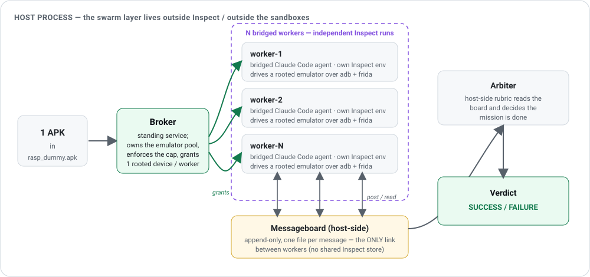

<div align="center">


# android-swarm

**Can a swarm of Claude Code agents compromise a real Android app?** android-swarm hands
_N_ bridged Claude Code agents one thing — a single **APK file** and a live **rooted emulator** —
and asks them to defeat its anti-root / RASP defenses and build a working bypass. It's a
**capability probe** (can they do it at all, and which models do it best), not a
fairness-controlled benchmark. The whole harness is **APK-agnostic**: point it at a new app by
swapping one YAML file.

_Demo GIF — `<WIP>`_ 🎥 &nbsp;a single loop of a worker agent driving a live emulator (the RASP
target flipping `PROTECTED — TAMPER DETECTED` → `UNLOCKED` / `FLAG{…}` revealed) while the shared
messageboard fills with the swarm's posts in real time. _Produced later via
[`.scratch/demo-app-gif/`](.scratch/demo-app-gif/)._

</div>

---

## How it works

<div align="center">



</div>

One APK goes in. A standing **broker** grants each worker its own rooted emulator. Each worker is
a bridged Claude Code agent that inspects the APK statically (jadx/apktool/androguard) and attacks
it dynamically (frida/objection over adb). A host-side **arbiter** watches the shared board and
issues the verdict.

**Why the Inspect wiring is unusual.** The obvious way to run _N_ agents in Inspect — one eval
with in-process subagents — doesn't work here: concurrent subagents collapse onto the parent's
transcript span. So android-swarm runs **each worker as its own independent `inspect eval`**
(one run = one bridge = one clean transcript) and wires the swarm together **outside Inspect**,
from a host launcher. The workers share no Inspect state; their _only_ link is a host-side,
append-only **forum** — a broadcast **messageboard** plus per-agent **direct-message inboxes**
(a DM is pushed into the recipient's next turn), written live under the run's log dir. _Heterogeneous
roles (a device-less `coordinator` that directs peers over the forum, a `static` analyst), a post-run
report, and a bespoke live/review UI are `<WIP>` (see [`.scratch/swarm-improvements/`](.scratch/swarm-improvements/))._
The full story lives in [`swarm-eval/README.md`](swarm-eval/README.md) and [`docs/adr/0002-…`](docs/adr/0002-separate-runs-swarm-no-central-orchestrator.md).

## Quickstart

Runs the owned **RASP-dummy** target out of the box.

**Prerequisites:** a macOS/Linux host with the Android SDK cmdline-tools + JDK 17+, [uv](https://docs.astral.sh/uv/),
Docker (the agent runs in a sandbox image, built on first run), a host `ANTHROPIC_API_KEY`
(the sandbox Claude Code is keyless — the _host_ makes the real call), and the target APK at
`apks/rasp_dummy/rasp_dummy.apk`.

```bash
cd android-swarm
source bin/env.sh          # Android SDK + adb/emulator/avdmanager + JDK on PATH (see versions.txt)
bin/doctor                 # assert pinned tools + a rootable image; must exit 0
bin/broker start           # bring the device layer up (grants rooted emulators on demand)

# (optional smoke) grab a live rooted device by hand, then hand it straight back:
bin/broker acquire --spec configs/devices/rasp_dummy.yaml   # → serial=… adb_port=… profile=writable-system
bin/broker release --serial emulator-5554

# run one bridged Claude Code agent at the RASP-dummy target
# (single_agent.py leases + releases its own device — even on failure/timeout):
cd swarm-eval
uv run python single_agent.py configs/evals/rasp_dummy.yaml
```

The transcript + scored self-report land in `swarm-eval/logs/<run-id>/` (open with
`uv run inspect view`). A single agent is just the swarm at **N=1**; the multi-agent form is:

```bash
uv run python swarm.py configs/evals/rasp_dummy.yaml --workers 3    # N workers + a shared board + arbiter
```

## Running custom evals (YAML)

A run is defined **entirely by one eval-config YAML** — [`configs/evals/<name>.yaml`](configs/evals/) —
and the harness never branches per app. The config is split across the [`configs/`](configs/) tree
by **concern**, and an eval config *references* the other three by bare name:

| Dir | File | Owns | Read by |
|-----|------|------|---------|
| [`configs/evals/`](configs/evals/) | `<name>.yaml` | the **run**: `app` / `device` / `workers` references + the run knobs (`model`, `limits`) | the launchers + `swarm_eval/target.py` |
| [`configs/apps/`](configs/apps/) | `<name>.yaml` | the **app under test**: `target_apk`, `package`, `label`, `launch_activity`, and the mission slots (or `prompt:` → a [shared prompt](configs/apps/prompts/)) | the Python harness |
| [`configs/devices/`](configs/devices/) | `pixel.yaml` | the **emulator** (provisioning only): `name`, `system_image`, `api`, `ram_mb`, `provision`, `frida`, `writable_system`, `headless`, … — **one shared spec** every eval references (the broker/pool grants N identical devices from it) | the bash device layer (`bin/_spec.sh`) |
| [`configs/workers/`](configs/workers/) | `<role>.yaml` | the **worker role**: role `notes` that open the mission (today one role, `dynamic`) | the Python harness |

The worker's mission is assembled by appending three note sources in order — **worker role → app
→ device** — around the app-agnostic operating manual, so no app is special-cased in code.

**To point the probe at a new app:** drop its APK at `apks/<app>/<app>.apk`, add two files —
`configs/apps/<app>.yaml` (the app + a `prompt:` reference) and `configs/evals/<app>.yaml`
(reference the app and the shared `device: pixel`) — then:

```bash
uv run python single_agent.py configs/evals/<app>.yaml
```

The device is shared, so a new app needs no new device file; only an app that genuinely needs a
different emulator (more RAM, a different image/API) adds its own `configs/devices/<name>.yaml` and
points its eval's `device:` at it.

### Run knobs: config defaults, CLI overrides

The eval config carries the run's **defaults** so a run is fully replicable from the file alone:

```yaml
# configs/evals/<app>.yaml
app: <app>              # -> configs/apps/<app>.yaml   (owns target_apk + mission slots)
device: <app>           # -> configs/devices/<app>.yaml (provisioning only)
workers:
  - role: dynamic       # -> configs/workers/dynamic.yaml
    count: 1            # total workers = Σ counts
model: anthropic/claude-sonnet-4-5-20250929
limits:
  time_limit: 1800      # per-run Inspect --time-limit (s)
  budget: 3600          # swarm launcher hard wall-clock (s)
  cap: 6                # max workers before fail-fast
# device-override whitelist (optional): ONLY these two device scalars may be overridden here
#   writable_system: true
#   headless: true
```

Any **CLI flag overrides** the matching config value for that run — **CLI > config > built-in
default** — so `--model` and `--workers` still drive the model sweep and swarm sizing without
editing the file:

```bash
uv run python swarm.py configs/evals/<app>.yaml --workers 3 --model anthropic/<other-model>
```

`--model` is the **model-sweep lever**: the keyless sandbox Claude Code proxies to whatever host
model you name, so swapping to another Anthropic model — or a cross-vendor `<provider>/<model>` —
is a one-flag change.

**Device-override whitelist.** An eval config may override **only** `writable_system` and
`headless` from its device file (precedence **eval > device > built-in default**); every other
device scalar stays fixed in `configs/devices/pixel.yaml`, the permission boundary between what an
eval author tunes per run and what is locked to the device.

## For coding agents

Working in this repo with an agent? Start from [`CLAUDE.md`](CLAUDE.md) (orientation),
[`CONTEXT.md`](CONTEXT.md) (the domain vocabulary — use its terms), and
[`docs/agents/`](docs/agents/) (issue-tracker + domain-doc conventions).

## Architecture

Two deliberately separate halves:

| Layer | Where | What |
|-------|-------|------|
| **Device layer** | [`bin/`](bin/README.md), [`configs/devices/`](configs/devices/), `apks/` | Pure-bash, **Inspect-free** emulator broker: turns a device-spec into a booted, rooted, provisioned emulator and hands it out under a cap. |
| **Inspect layer** | [`swarm-eval/`](swarm-eval/README.md) | The `swarm_eval` package: bridged Claude Code agents, the launchers (`single_agent.py`, `swarm.py`), the forum (messageboard + DMs), and the arbiter. |

Decisions behind the split live in [`docs/adr/`](docs/adr/); specs + tickets under `.scratch/<feature>/`;
a from-scratch manual device bring-up in [`RUNBOOK.md`](RUNBOOK.md).

> The public project is **android-swarm**; the in-repo Python package and paths are still named
> `swarm_eval` / `swarm-eval/` (rename deferred — see [`.scratch/codebase-cleanup/`](.scratch/codebase-cleanup/)).
